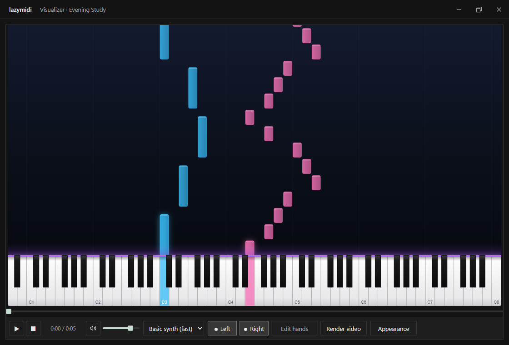

<p align="center"></p>
<h1 align="center">lazymidi</h1>
<p align="center">Play virtual piano with a MIDI controller or Wooting keyboard, convert piano audio to MIDI, and make sheets and piano-roll videos.</p>
<p align="center">
  <a href="https://github.com/LioK251/lazymidi/releases/latest"><strong>Download</strong></a> ·
  <a href="https://lazymidi.vercel.app/">Website</a> ·
  <a href="docs/optional-modules.md">Setup guide</a>
</p>



## Download

| Platform | Packages |
| --- | --- |
| **Windows x64** | Installer and portable ZIP. Extract the entire ZIP and keep `_up_` beside `lazymidi.exe`. |
| **macOS 14+** | Experimental DMGs for Apple Silicon and Intel. |
| **Linux x64** | Experimental `.deb` and AppImage. |

Windows builds are unsigned, and macOS builds use ad-hoc signing. The macOS packages include the Wooting Analog SDK. Install the SDK separately on Windows and Linux. [Platform details](#platform-status)

## Quick start

| Goal | Where to start |
| --- | --- |
| **Play virtual piano** | Choose **MIDI Controller** or **Analog Keyboard** in **Play**. Select the **Visual Pianos · 88 keys** profile and enable **MIDI → QWERTY**. |
| **Convert audio to MIDI** | Enable **Converter** in Settings, then open **Convert → Runtime setup → Install Converter**. Once setup finishes, select an audio file or paste a supported media link. |
| **Read or export a sheet** | Choose **Sheet** on a Library card. **QWERTY** shows game keys and exports a full-sheet PNG. **Piano** shows staff notation with playback, MusicXML export, and printing to PDF. |
| **Make a piano-roll video** | Open a Library preview, adjust **Appearance**, and choose **Render video** to export a WebM at the song’s original tempo. Add an `.sf2` piano from the **SoundFont** dropdown. |
| **Queue conversions from Chromium** | Load the unpacked extension and keep Converter running. Submit supported media from YouTube, TikTok, or Discord and follow each job in the popup. [Extension setup](extension/README.md) |

The optional **Transposer** sends a transpose sequence to the game. Assign the game’s Up/Down keys and open the floating monitor to use it. Start the game at transpose 0 so the monitor can track each change. [Transposer setup](docs/optional-modules.md)

Use **Settings → Modules** to manage Converter and Piano actions. Discord presence and its GitHub button have separate switches in Settings. [Module setup](docs/optional-modules.md)

## Play Visual Pianos

1. Open **Play** and keep the **Visual Pianos · 88 keys** profile selected.
2. For a MIDI keyboard, choose **MIDI Controller** and select a device if several are present. For Wooting, choose **Analog Keyboard** and enable analog input. On Windows and Linux, install the [Wooting Analog SDK 0.9.1](https://github.com/WootingKb/wooting-analog-sdk/blob/v0.9.1/docs/INSTALL.md) first. On macOS, leave the SDK library path blank to use the SDK included in the DMG.
3. Enable **MIDI → QWERTY**, then focus [Visual Pianos on Roblox](https://www.roblox.com/games/5593470048/Visual-Pianos). Enable the game's corresponding 88-key and velocity controls if its current UI requires them.
4. Use **Panic** to stop transport and release owned keys, notes, and pedals. Output starts off at launch and after input disconnection; reconnecting never arms it.

The game preset adapts the MIT `miditoqwerty-rs` Piano Visualizations protocol: Shift for black notes, Ctrl for notes below C2/above C7, and Alt plus one of 32 keys for MIDI velocity. CC64 sends Space; CC66 sends `]`. In **Mapping → Profile**, **Velocity** controls Alt-key velocity output, **Sustain** controls CC64 pedal output, and **88 Keys** controls extended note output. These toggles are available in both mapping modes. With **88 Keys** off, QWERTY output is limited to C2–C7 (notes 36–96); the 88-key editor, saved mappings and MIDI output remain intact. Sustain retains its assigned key when switched off. Automated tests cover the protocol, and the user reported satisfactory operation before the 0.1.2 release. The game's current behavior and keyboard layout can affect compatibility; independent input-to-audio latency measurement remains outstanding.

**Analog setup:** physical Wooting typing is not suppressed. Configure a Wootility profile with the mapped digital keys disabled if you want only lazymidi's generated game input. Otherwise physical and generated presses can overlap. This does not affect other ordinary keyboards.

The supplied analog preset remains unchanged: HID → MIDI note, zero-based channels, threshold 0.5, velocity scale 1, and Left Shift transposition 1 semitone. The `Default copy` profile retains its 36 inverse bindings. A separate Visual Pianos profile adds game output for all notes A0–C8. Analog keyboards have fewer physical keys; use the editor and transposition to choose the range you play.

When analog input is enabled, **Play** shows Shift amount, Note trigger threshold and Velocity scale. Edit them as a draft, then **Apply analog settings**. The existing SDK connection stays active if its device/path/polling/input mode have not changed; generated output releases and requires re-enabling. Threshold is normalized depth (0–less than 1), velocity scale multiplies the depth-over-time estimate, and Shift amount is semitone transposition while Left Shift is held.

Enable analog input to detect Wooting hardware through the SDK. Its MIDI conversion model feeds the mapper used by physical MIDI controllers. The Visual Pianos profile enables Alt-key velocity output by default.

## Edit mappings

In **Mapping**, select Analog → MIDI or MIDI → QWERTY. The 88-key piano spans MIDI notes 21–108. Click a note, choose a HID usage or click **Capture key**, and assign it. Capture uses physical `KeyboardEvent.code` only while that button has focus; it does not turn an ordinary keyboard into a musical input. Escape cancels. Analog assignment moves that physical key within the selected channel; the table also supports multiple bindings.

Output notes can have Shift and Ctrl modifiers. The game adapter pulses modifiers around each key-down, rather than holding them through the note. Profiles use drafts; **Apply profile** validates and saves all edits, releases output, and requires re-enabling it. Duplicate, import/export, restore, and MIDI learn are available. Imports never enable generated keys. The original default JSON is embedded in `crates/lazymidi-core/resources/presets/default-analog.json`.

Switching between Play and Mapping keeps Analog and MIDI → QWERTY enabled. Mapping, editing fields and dialogs temporarily pause generated keys; returning to Play resumes once all pause reasons clear. Converter text and number fields accept generated keys, including analog → MIDI → QWERTY typing with digital keys disabled in Wootility. Held notes must be released and pressed again after a pause. This does not interrupt ordinary MIDI routes or unload the SDK. A keyboard-send failure disables only QWERTY output while preserving working analog input.

On Windows, analog input uses a high-resolution timer while enabled. New settings default to 1000 Hz; saved polling preferences remain unchanged. Already-queued notes share an ordered keyboard batch without waiting to collect more notes, reducing redundant velocity commands within that batch. Timing diagnostics are opt-in; see [testing](docs/testing.md) for measurements and limitations.

Synthetic key protocols have a ceiling: multiple pitches can use the same physical key, and velocity-setting keys overlap with note keys. The adapter follows upstream retrigger behavior and keeps ownership until the final release, but a game's handling of those collisions determines audible polyphony. The app cannot independently encode arbitrary MIDI voices through a single keyboard key.

## Sequencer and routing

The Sequencer tab and its Play shortcut are currently hidden. Existing project/transport code is retained; it does not start playback or recording automatically.

Four tracks, 16 sixteenth-note steps, 20–300 BPM, per-note velocity and per-step gate. Default gate is 80%. Select an armed track and enable Record. Stopped recording replaces a step and advances; playback recording overdubs into the step active at the first note. Chords group after 30 ms of quiet, capped at 100 ms. This is step recording, not free-time performance recording.

Choose a MIDI destination or explicitly route a track to QWERTY. Generated playback additionally requires the Play toggle. Project files have the `.lazymidi` extension. Advanced routing supports both live inputs, channel filters and remapping. Internal playback → recorder cycles and duplicate routes are rejected. Without explicit recorder routes, recording captures the active live input into the armed track; explicit recorder routes replace that default tap for their source.

Destination routes belong to the active profile; project files store notes, gates, tempo and track properties. Select the matching profile when reopening a project.

## Develop and build

Install Node 22+ and stable Rust **1.91+**, plus the [Tauri platform prerequisites](https://v2.tauri.app/start/prerequisites/). The lockfile includes newer transitive dependencies, so 1.91 is the tested toolchain. Run:

```sh
npm ci --ignore-scripts
npm run desktop
```

Frontend-only preview: `npm run dev` at `http://127.0.0.1:1420`. It never accesses native MIDI/SDK/keyboard output and clearly labels itself as a browser preview.

```sh
cargo test --workspace
cargo test -p lazymidi-core --no-default-features
cargo clippy --workspace --all-targets -- -D warnings
npm test
npm run build
python converter/test_environment.py
# Service tests need no model/GPU:
python -m pip install -r converter/requirements-test.txt
python converter/test_service.py
python converter/test_piano_sheet.py
cargo fetch --locked
npm run notices
npm run bundle -- --bundles nsis
```

Prepare the platform tools with the **Runtime tools** workflow before packaging. The Linux packages workflow includes the ALSA runtime dependency. The macOS DMG workflow builds and bundles the Wooting SDK for each architecture. The SDK loader is an optional core Cargo feature. [Build and qualification](docs/optional-modules.md#build-and-qualification)

The **macOS DMG** workflow in [GitHub Actions](https://github.com/LioK251/lazymidi/actions/workflows/macos-build.yml) builds separate Apple Silicon (`aarch64`) and Intel (`x86_64`) DMGs for macOS 14+. The apps use ad-hoc signatures and are not notarized. Real-device MIDI, keyboard permission, Wooting and Roblox checks remain hardware-dependent. Converter runtimes are downloaded separately from inside the app.

The **Linux packages** workflow builds x64 packages on Ubuntu 22.04 and checks the packaged app under X11. Install the downloaded `.deb` with `apt` to resolve dependencies. Mark the downloaded AppImage executable before opening it. Keyboard output requires `uinput` access. Global shortcuts require X11 on Linux. [Linux packages workflow](https://github.com/LioK251/lazymidi/actions/workflows/linux-build.yml)

## Persistence and recovery

Settings live in the platform application configuration directory returned by `directories::ProjectDirs` (`app / lazymidi / lazymidi`), not alongside the executable. Files use a version 1 envelope. Existing v1 profiles without game/modifier fields load with safe defaults. Profiles missing the new sustain/extended-key toggles preserve their previous output behavior. Legacy unversioned analog JSON can be imported. Future versions are rejected. JSON imports are limited to 1 MiB.

Writes use a same-directory temporary file, sync, atomic replacement, and one `.backup`. Invalid settings are preserved in timestamped `.invalid-*.json` files before a subsequent save replaces them. A valid backup is used on recovery; otherwise built-in defaults load with a warning. Failed settings saves leave the running settings unchanged. Project save only clears dirty state if the saved content is still current.

## Platform status

| Feature | Windows 11 x64 | Linux ALSA / X11 / Wayland | macOS Intel / Apple Silicon |
|---|---|---|---|
| Desktop build | Built locally | Experimental x64 .deb/AppImage; packaged startup verified, hardware QA pending | Experimental Apple Silicon/Intel DMGs; native startup verified, hardware QA pending |
| MIDI input/output | WinMM adapter | ALSA adapter | CoreMIDI adapter |
| QWERTY output | SendInput, target integrity restrictions | uinput, device permissions and target/compositor restrictions | CoreGraphics, Accessibility required |
| Wooting input | Install the compatible SDK | Install the SDK and configure HID permissions | SDK bundled with the DMG |
| Sequencing/profiles | Tested core | Shared core; native OS QA outstanding | Shared core; native OS QA outstanding |
| App-created virtual output | Deferred | Implemented using midir | Implemented using midir |

Adapters being present does not imply hardware qualification. See [testing](docs/testing.md) and [architecture](docs/architecture.md) for current evidence and remaining manual gates. No cleanup guarantee is possible after force-kill, OS failure, or removed output hardware.

## Licensing

Original code is MIT. Adapted Wooting analog calculations, ArijanJ keyboard/game translations, Multi-Transpose behavior and mp3converter components retain their notices in `THIRD_PARTY_NOTICES` and the bundled license files. The app downloads Python, PyTorch and the piano model only when Converter is installed. It bundles an LGPL FFmpeg build and a small ncls wheel so setup needs no compiler. Dependency licenses are retained; matching [FFmpeg/OpenSSL/LAME sources](https://lazymidi.vercel.app/third-party/) and the build recipe are available. The macOS packages include Wooting’s MPL 2.0 SDK and its license. The visualizer includes LGPL FluidSynth with its license, source archive and rebuild instructions. Regenerate application dependency notices with `npm run notices` before packaging.
